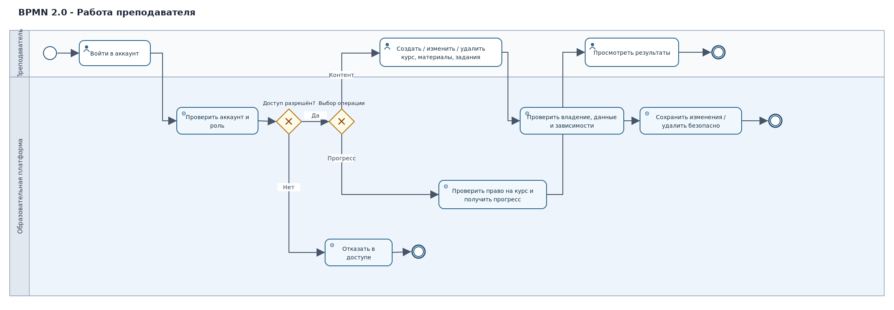
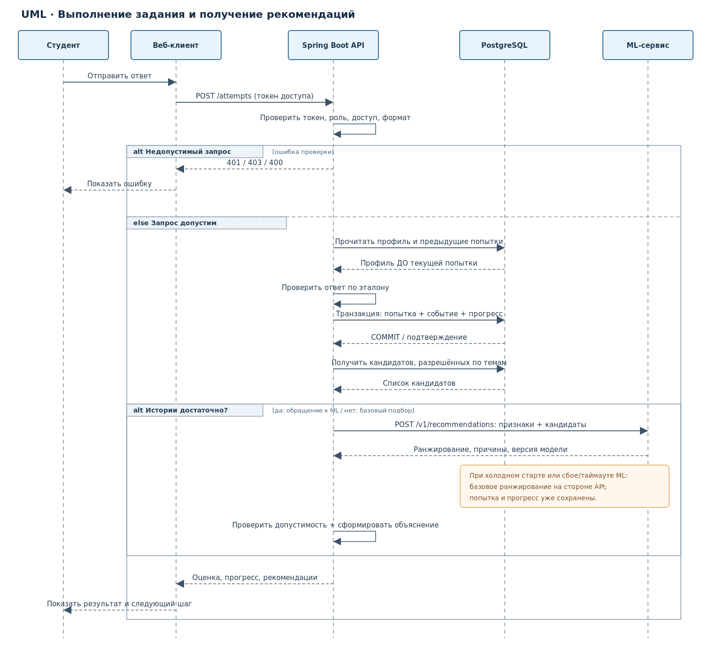
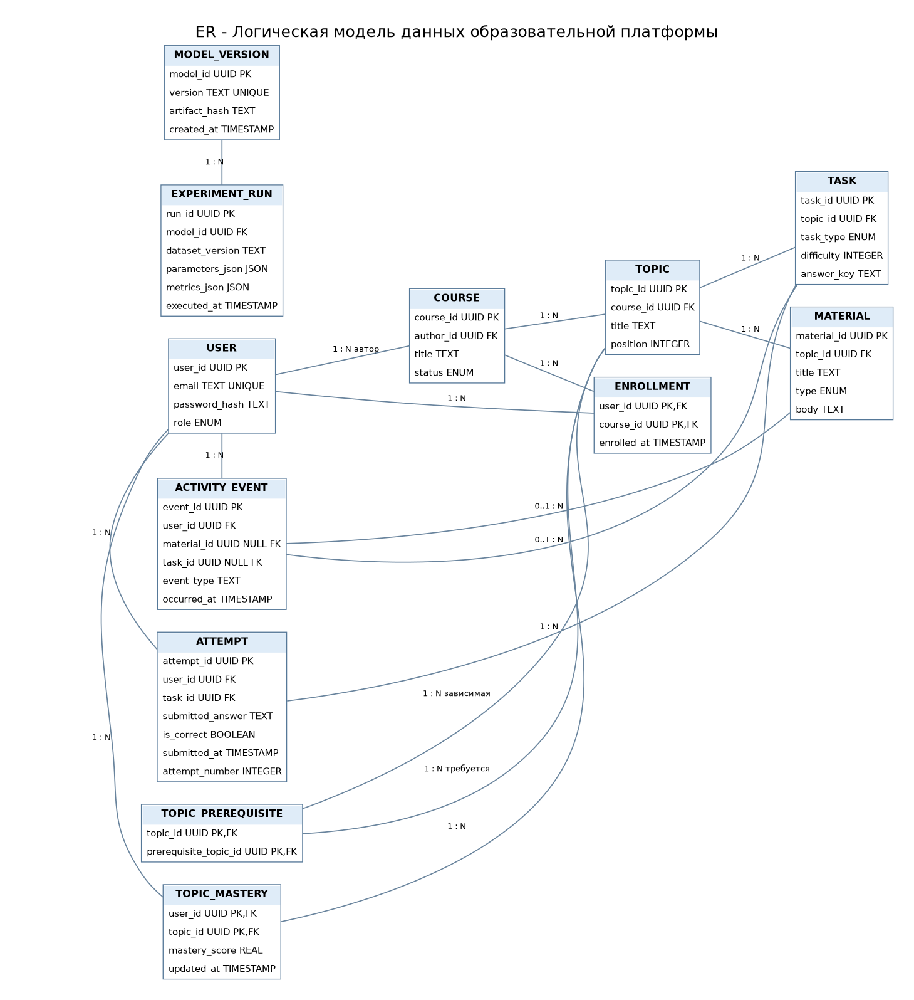
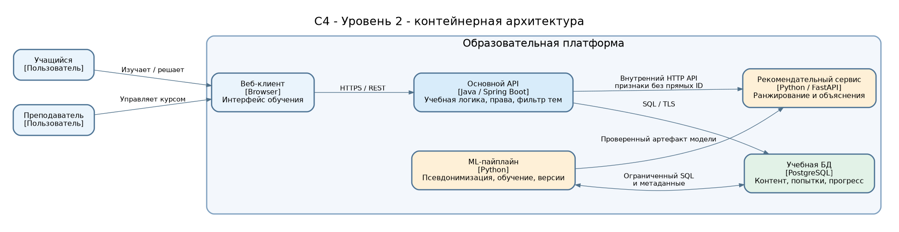
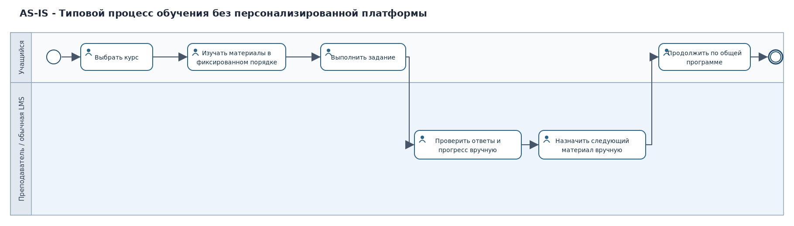
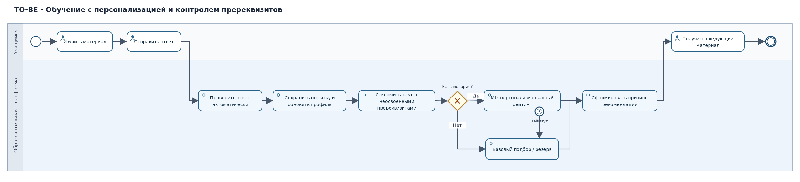

# ЛР 3 - Проектирование информационных систем

**Тема ВКР:** Разработка серверной части интеллектуальной образовательной платформы с персонализированной рекомендательной системой.

**Участники проекта:** 

- Матвей Дроздов Вячеславович - ML (рекомендательная система)
- Соболев Артём Анатольевич - Backend (Java/Spring Boot)

**Распределение вклада участников в ЛР №3 (предлагаемое; перед сдачей сверить с фактически выполненной работой):**

- **Дроздов Матвей (ML):** формулирование требований к персонализации, ограничениям по предварительным темам, объяснимости рекомендаций и холодному старту (FR-07–FR-09, FR-12; NFR-02, NFR-05, NFR-06, NFR-08); проектирование этапов отбора кандидатов, ранжирования и резервной стратегии в BPMN-модели TO-BE; описание входных признаков и выходного контракта ML-сервиса, обезличивания данных, версионирования моделей и воспроизводимости экспериментов.
- **Соболев Артём (Backend):** формулирование требований к регистрации и правам доступа, управлению курсами, проверке заданий, хранению попыток и прогресса (FR-01–FR-06, FR-10; NFR-01, NFR-03, NFR-04, NFR-07); проектирование логической модели данных (ER), диаграммы последовательностей выполнения задания (UML), контейнерной архитектуры (C4) и процесса управления курсами преподавателем (BPMN); проработка REST API, целостности данных и взаимодействия основного сервера с рекомендательным модулем.
- **Совместно:** обзор и обоснование нотаций; согласование границ ответственности Backend и ML, структуры API и потоков данных; моделирование процессов AS-IS и TO-BE; сопоставление диаграмм с FR/NFR и формулирование выводов.

## 1. Предметная область и требования

### Описание предметной области

Разрабатываемая система - **образовательная платформа с персонализированными рекомендациями** материалов и практических заданий. Её цель - адаптировать последовательность обучения к текущему уровню знаний, результатам проверки заданий, истории действий пользователя и связям между темами.

**Участники и роли:** учащийся изучает материалы, выполняет задания, получает обратную связь и рекомендации; преподаватель создаёт и изменяет курсы, материалы и задания, просматривает результаты своих учащихся. Администратор может появиться в последующих итерациях, но не выделен как обязательная роль текущей модели.

**Основные процессы:** создание и ведение курсов; изучение материалов; автоматическая проверка заданий; фиксация учебной активности; обновление профиля освоения тем; фильтрация допустимых тем по предварительным требованиям; персонализированное ранжирование материалов; объяснение рекомендаций; просмотр прогресса преподавателем.

В рамках ВКР проектируются основной сервер на Java / Spring Boot, реляционное хранилище PostgreSQL и интеграция с отдельным ML-сервисом по версионированному API. Клиент показан на уровне контейнеров как веб-приложение; выбор его конкретного фреймворка в данной работе не принципиален.

### Функциональные требования

| ID | Требование | Как проверить выполнение |
|---|---|---|
| **FR-01** | Система должна обеспечивать регистрацию, вход в учётную запись и разграничение доступа как минимум для учащегося и преподавателя. | Создать учётные записи двух ролей; проверить вход, выход и недоступность функций преподавателя учащемуся. |
| **FR-02** | Преподаватель должен иметь возможность создавать, редактировать и удалять курсы, темы и учебные материалы. | Создать тестовый курс с двумя темами и материалами, изменить его содержание и удалить один материал; проверить отображение изменений учащемуся. |
| **FR-03** | Преподаватель должен иметь возможность добавлять задания к темам, указывать их сложность и правильные ответы для автоматически проверяемых заданий. | Создать задания разной сложности с правильными ответами; проверить сохранение параметров и отображение заданий в курсе. |
| **FR-04** | Учащийся должен иметь возможность открывать материалы, выполнять задания и получать результат автоматической проверки. | Выполнить задания с правильным и неправильным ответом; убедиться, что система возвращает соответствующий результат. |
| **FR-05** | Система должна сохранять историю учебной активности: открытие материалов, ответы на задания, результаты, число попыток и время взаимодействий. | Совершить несколько действий от имени учащегося и проверить наличие соответствующих записей в базе данных или через API. |
| **FR-06** | Система должна формировать цифровой профиль учащегося, включающий прогресс по темам и результаты выполненных заданий. | Выполнить несколько заданий по двум темам; проверить обновление показателей профиля в соответствии с полученными результатами. |
| **FR-07** | Система должна выдавать персонализированный ранжированный список учебных материалов или заданий на основе характеристик контента и истории обучения учащегося. | Подготовить два профиля с различными результатами обучения; запросить рекомендации и проверить корректность формата, ранжирования и учёт различий между профилями. |
| **FR-08** | При формировании рекомендаций система должна учитывать предварительные требования к темам и не рекомендовать зависимые темы в качестве следующего шага, если необходимые темы ещё не освоены. | Создать зависимость между темами; запросить рекомендации до и после освоения предварительной темы и проверить изменение доступных рекомендаций. |
| **FR-09** | Система должна предоставлять объяснение причины рекомендации, например связь с темой, уровнем сложности или выявленными затруднениями учащегося. | Получить рекомендации и проверить наличие объяснения для каждого рекомендованного элемента. |
| **FR-10** | Преподаватель должен иметь возможность просматривать результаты и прогресс учащихся по доступным ему курсам. | Выполнить тестовые задания от имени учащегося; проверить отображение оценок и прогресса преподавателю соответствующего курса. |
| **FR-11** | Архитектура должна обеспечивать возможность подключения и замены рекомендательной ML-модели без изменения основных сценариев работы платформы. | Подключить две реализации рекомендательного модуля, переключить конфигурацию и убедиться, что платформа продолжает получать рекомендации через согласованный интерфейс. |
| **FR-12** | При отсутствии истории обучения система должна выдавать начальные рекомендации на основе характеристик материалов и/или их популярности (сценарий холодного старта). | Создать нового учащегося без выполненных заданий; запросить рекомендации и проверить получение непустого списка при наличии подходящего контента. |

### Нефункциональные требования

| ID | Требование | Как проверить выполнение |
|---|---|---|
| **NFR-01** | При испытании на согласованном тестовом стенде 95-й перцентиль времени ответа основных API-операций (получение курсов, материалов, результатов) должен быть **не более 2 секунд** при **20 одновременных пользователях**. | Провести нагрузочное тестирование основных API-сценариев при 20 виртуальных пользователях; проверить показатель p95 отдельно для указанных операций. |
| **NFR-02** | При тех же условиях 95-й перцентиль времени формирования рекомендаций должен быть **не более 5 секунд**. | Выполнить нагрузочный тест эндпоинта рекомендаций при 20 виртуальных пользователях; проверить p95. |
| **NFR-03** | Доступ к данным пользователей и преподавательским операциям должен ограничиваться авторизацией и ролевыми правами; пароли не должны храниться в открытом виде. | Проверить попытки неавторизованного доступа и доступа с неподходящей ролью; проверить, что в БД отсутствуют пароли в открытом виде. |
| **NFR-04** | Система должна обеспечивать сохранность связей между пользователями, курсами, заданиями и результатами при создании и изменении записей. | Выполнить тесты целостности БД: попытаться создать результат для несуществующего задания и удалить связанные данные; проверить корректную обработку ограничений. |
| **NFR-05** | Рекомендательный модуль должен предоставлять документированный программный интерфейс для получения рекомендаций и объяснений, не зависящий от конкретного алгоритма. | Сверить API с документацией; выполнить одинаковый набор запросов с двумя реализациями модуля и проверить соответствие ответов контракту. |
| **NFR-06** | Результаты экспериментов с рекомендательной моделью должны быть воспроизводимыми: фиксируются версия модели, версия набора данных, параметры эксперимента и показатели качества. | Повторно запустить эксперимент с зафиксированными параметрами и проверить наличие отчёта с метриками Precision@K, Recall@K, NDCG@K (при наличии разметки) и AUC-ROC (для прогноза правильности ответа). |
| **NFR-07** | При недоступности рекомендательного модуля основные функции прохождения курсов и сохранения результатов должны оставаться доступными; ошибка рекомендаций должна обрабатываться без потери данных. | Остановить сервис рекомендаций и проверить открытие учебных материалов, выполнение задания, сохранение ответа и отображение понятного сообщения об ошибке рекомендаций. |
| **NFR-08** | Данные для обучения и оценки ML-модели должны обрабатываться без прямых персональных идентификаторов учащихся, если они не требуются для алгоритма. | Проверить структуру подготовленного датасета и отсутствие ФИО, электронной почты и иных прямых идентификаторов. |

**Пояснения к проверяемости:** NFR-01 и NFR-02 задают *целевые показатели*, которые требуют отдельного нагрузочного тестирования на согласованном стенде, а не могут быть доказаны диаграммами. Для NFR-06 версия набора данных подразумевает также фиксированное разбиение, а в параметрах эксперимента фиксируется seed и конфигурация модели. В NFR-08 удаляются прямые идентификаторы; сохраняющийся технический ключ пользователя является **псевдонимом**, а не гарантией полной анонимности.

## 2. Краткий обзор нотаций и видов диаграмм

| Нотация или вид диаграммы | Что описывает | Сильные стороны |
|---|---|---|
| **BPMN** | Бизнес-процессы, последовательность действий, участников и условия переходов. | Наглядно отображает процессы обучения, проверки заданий и формирования рекомендаций. |
| **IDEF0** | Функции системы, их входы, выходы, механизмы и управляющие воздействия. | Позволяет декомпозировать сложную систему на функциональные блоки и определить их взаимосвязи. |
| **IDEF3** | Сценарии выполнения процессов и последовательность операций. | Удобна для описания альтернативных сценариев обучения и логики прохождения заданий. |
| **ER-диаграмма** | Сущности базы данных, их атрибуты и связи между ними. | Помогает спроектировать структуру базы данных и определить связи пользователей, курсов и заданий. |
| **DFD** | Потоки данных между процессами, внешними сущностями и хранилищами. | Позволяет проследить передачу образовательных данных между компонентами системы и ML-модулем. |
| **UML: диаграмма вариантов использования** | Функциональные возможности системы и взаимодействие пользователей с ними. | Помогает определить требования и разграничить действия студента, преподавателя и администратора. |
| **UML: диаграмма классов** | Структуру классов, их атрибуты, методы и отношения. | Упрощает объектно-ориентированное проектирование серверной части и определение связей программных сущностей. |
| **UML: диаграмма последовательностей** | Взаимодействия компонентов и порядок обмена сообщениями во времени. | Подходит для описания обращения к API, выполнения заданий и получения рекомендаций от ML-сервиса. |
| **UML: диаграмма активности** | Алгоритмы, последовательности действий, ветвления и параллельные операции. | Позволяет детализировать логику проверки ответов и формирования рекомендаций. |
| **UML: диаграмма состояний** | Состояния объектов и переходы между ними в ответ на события. | Помогает моделировать жизненный цикл задания, попытки тестирования или прохождения курса. |
| **UML: диаграмма компонентов** | Программные компоненты, предоставляемые интерфейсы и зависимости. | Позволяет представить модульную архитектуру платформы и взаимодействие серверной части с рекомендательным модулем. |
| **UML: диаграмма развёртывания** | Размещение программных компонентов на серверах и вычислительных узлах. | Помогает спланировать инфраструктуру, размещение API, базы данных и ML-сервиса. |
| **C4-модель** | Архитектуру программной системы на уровнях контекста, контейнеров, компонентов и кода. | Позволяет последовательно описать архитектуру от общего представления платформы до внутренних программных модулей. |
| **DMN** | Правила и логику принятия решений, условия выбора и таблицы решений. | Удобна для формализации правил назначения заданий с учётом уровня знаний и результатов обучения. |

Приведённый обзор охватывает **14 позиций**. Для непосредственного проектирования выбраны четыре представления, перечисленные в следующем разделе. Их применение предполагается согласовать с научным руководителем.

## 3. Выбор и обоснование нотаций для ВКР

Выбраны **четыре** нотации / вида диаграмм. Вместе они охватывают процессы, взаимодействия, данные и архитектуру и не дублируют назначение друг друга.

| Выбранная нотация / вид | Что моделируется | Связанные требования | Обоснование и способ проверки по модели |
|---|---|---|---|
| **BPMN 2.0** | Процессы обучения, преподавательские операции, состояния AS-IS и TO-BE | FR-01–FR-10, FR-12; NFR-03, NFR-04, NFR-07 | Задачи, шлюзы и граничные события фиксируют порядок проверки ответа, записи результата, выбора рекомендаций, ограничения доступа и независимой обработки отказа ML. |
| **UML: диаграмма последовательностей** | Обмен запросами между учащимся, клиентом, Spring Boot API, PostgreSQL и ML | FR-01, FR-04–FR-09, FR-11, FR-12; NFR-02–NFR-05, NFR-07, NFR-08 | Показывает сообщения, транзакционные границы и альтернативы успешного, неуспешного и холодного сценариев; позволяет вывести интеграционные тесты. |
| **ER-модель** | Логическая структура пользовательских и учебных данных, результатов и метаданных экспериментов | FR-01–FR-06, FR-08, FR-10; NFR-03, NFR-04, NFR-06, NFR-08 | Проверяет наличие необходимых сущностей, ключей, ограничений и отношения между попытками, освоением тем и предварительными требованиями. |
| **C4: уровень 2 (Container)** | Контейнеры веб-клиента, основного API, базы данных, ML-сервиса и ML-пайплайна | FR-01–FR-12; NFR-01–NFR-03, NFR-05–NFR-08 | Позволяет проверить границы ответственности, изоляцию ML, способ интеграции, пути данных и проектные предпосылки отказоустойчивости и безопасности. |

**Разделение задач:** бизнес-логику наиболее явно отражает BPMN; модель хранения - ER; взаимодействия компонентов и порядок обработки данных - UML; архитектурные границы и зависимости - C4. Нефункциональные требования связаны с конкретными решениями, но окончательно подтверждаются испытаниями и аудитом реализации.

## 4. Проектирование системы

### 4.1. BPMN 2.0 - операции преподавателя

**Исходник BPMN 2.0:** [`01-teacher-process.bpmn`](../../assets/01-teacher-process.bpmn).

**Описание.** После входа основной API проверяет полномочия преподавателя. Ветвление разделяет управление контентом и просмотр результатов. Управление включает **создание, изменение и удаление** курсов, материалов и заданий. Для модификаций сервер проверяет принадлежность курса, корректность данных и ограничения на связанные записи. В ветке прогресса отображаются результаты только доступных преподавателю курсов. При отсутствии полномочий выдаётся отказ без изменения данных.

**Функциональные требования:** FR-01 - роль и аутентификация; FR-02 - полный набор CRUD-операций с контентом; FR-03 - материалы, задания, сложность и эталонные ответы (поля задания представлены в ER-модели); FR-10 - просмотр результатов собственных курсов.

**Нефункциональные требования:** NFR-03 - проверка токена и доступа *для каждого* защищённого запроса на сервере, хранение адаптивного хеша пароля (например, Argon2id); NFR-04 - проверка FK, обязательных значений и ограничений при удалении/обновлении; NFR-01 - операции чтения данных и управления курсом включаются в нагрузочный тест, но схема не является свидетельством достижения p95.

### 4.2. UML - последовательность выполнения задания

**Исходник диаграммы:** [`02-sequence-attempt.puml`](../../assets/02-sequence-attempt.puml).

**Описание.** Веб-клиент отправляет `POST /attempts` с токеном доступа. API проверяет аутентификацию, полномочия, принадлежность задания доступному курсу и формат ответа. Недопустимый запрос завершается `400`, `401` или `403` до изменения данных. Для допустимого запроса сервер читает предшествующую историю, вычисляет правильность ответа, в транзакции создаёт попытку, событие и обновляет прогресс; затем получает разрешённых кандидатов. При достаточной истории запрашивается `POST /v1/recommendations`; при холодном старте, отказе или таймауте используется резервный подбор. Ответ ML перепроверяется на допустимость, и клиент получает результат задания, прогресс и рекомендации.

**Функциональные требования:** FR-01 - авторизация; FR-04 - вычисление оценки; FR-05 - сохранение истории; FR-06 - обновление прогресса; FR-07–FR-09 - отбор, ранжирование и объяснение; FR-11 - стабильный версионированный контракт; FR-12 - холодный старт без вызова ML.

**Нефункциональные требования:** NFR-03 - контроль доступа перед модификацией; NFR-04 - атомарный COMMIT связанных записей; NFR-05 - контракт API ML независим от реализации модели; NFR-07 - ошибка ML не откатывает сохранённый ответ; NFR-08 - в ML передаются признаки и технический псевдоним при необходимости, **не** email/ФИО. NFR-02 оценивается отдельным нагрузочным тестированием.

**Проектное ограничение:** объединение проверки задания и рекомендаций в один клиентский сценарий не означает, что вызов ML входит в транзакцию БД. Если нужны дополнительные гарантии времени ответа, выдачу рекомендаций допустимо вынести в самостоятельный запрос, не меняя логическую последовательность.

### 4.3. ER - логическая модель данных

**Исходник диаграммы:** [`03-er-model.dot`](../../assets/03-er-model.dot).

**Структура модели.** `USER`, `COURSE`, `ENROLLMENT`, `TOPIC`, `MATERIAL` и `TASK` отвечают за пользователей и курсы. `ATTEMPT` хранит каждую выполненную попытку, включая ответ, результат, номер и время; `ACTIVITY_EVENT` - различные действия пользователя; `TOPIC_MASTERY` - агрегированный прогресс по теме. `TOPIC_PREREQUISITE` задаёт ориентированную связь «тема - требуемая ранее тема». `MODEL_VERSION` и `EXPERIMENT_RUN` содержат данные для воспроизводимости исследований.

**Кардинальности и ограничения:** один курс имеет одного автора и много тем; один учащийся может проходить много курсов через `ENROLLMENT`; одна тема имеет несколько материалов и заданий; попытка всегда относится ровно к одному существующему пользователю и заданию. У события активности ссылка на материал или задание необязательна и зависит от типа события (указано `NULL FK` в атрибутах). Пары `(user_id, course_id)`, `(user_id, topic_id)` и `(topic_id, prerequisite_topic_id)` имеют составные ключи. Для структуры БД также планируются:

- `CHECK (mastery_score BETWEEN 0 AND 1)`, `CHECK (difficulty >= 1)`, `CHECK (attempt_number >= 1)`;
- запрет прямой зависимости темы от самой себя и проверка отсутствия циклов в графе пререквизитов на уровне бизнес-логики/БД;
- защита связанных результатов при удалении курсов и заданий: вместо неограниченного `ON DELETE CASCADE` предусмотрено ограничение удаления или мягкое удаление опубликованного контента;
- согласованное обновление `TOPIC_MASTERY` и `ATTEMPT` в одной транзакции, уникальность номера попытки для пары `(user_id, task_id)`;
- ограничение доступа учащегося к `answer_key` на уровне серверного API, даже если он отображается в ER-модели.

**Функциональные требования:** FR-01 - `USER`; FR-02/03 - `COURSE`, `TOPIC`, `MATERIAL`, `TASK`; FR-04/05 - `ATTEMPT`, `ACTIVITY_EVENT`; FR-06 - `TOPIC_MASTERY`; FR-08 - `TOPIC_PREREQUISITE`; FR-10 - авторство курсов, записи на курс и результаты учащихся.

**Нефункциональные требования:** NFR-03 - `password_hash` и разграничение на уровне API; NFR-04 - PK/FK, уникальность и транзакции; NFR-06 - версии модели и данных, параметры/метрики экспериментов; NFR-08 - таблица пользователей не передаётся в ML целиком, её прямые идентификаторы исключаются на этапе подготовки признаков. Сама ER-схема не гарантирует защиту от реидентификации - это предмет отдельной проверки данных.

### 4.4. C4 - контейнерная архитектура (уровень 2)

**Исходник диаграммы:** [`04-c4-container.dot`](../../assets/04-c4-container.dot).

**Архитектурные решения.** Веб-клиент взаимодействует только с основным API по HTTPS/REST. Spring Boot API реализует проверку прав, управление курсами, валидацию ответов, хранение результатов, формирование профиля и фильтр пререквизитов. PostgreSQL хранит учебные и экспериментальные метаданные. ML-сервис (Python / FastAPI) предоставляет только ранжирование и причины выбора по версионированному контракту. ML-пайплайн подготавливает данные без прямых идентификаторов, обучает модели, фиксирует версии экспериментов и публикует проверенный артефакт модели; публикация не должна автоматически нарушать контракт API.

**Функциональные требования:** FR-01–FR-06 и FR-10 покрываются основным API и БД; FR-07/09 - ML-сервисом и выдачей объяснений; FR-08 - серверным фильтром; FR-11 - отделением ML за контрактом; FR-12 - резервной стратегией на основном API.

**Нефункциональные требования:** NFR-03 - изоляция БД/ML и проверка доступа на API; NFR-04 - единая транзакционная учебная БД; NFR-05 - документированный `/v1/recommendations`; NFR-06 - версионированный экспериментальный контур; NFR-07 - независимость образовательных транзакций от доступности ML; NFR-08 - минимизация передачи прямых идентификаторов. NFR-01/02: разделение контейнеров помогает локализовать нагрузку, но нормативы времени ответа **требуют тестов**, а не выводятся из схемы.

### 4.5. Матрица соответствия моделей требованиям

| Модель | Основные FR | Основные NFR | Что проверить позднее |
|---|---|---|---|
| BPMN: AS-IS / TO-BE | FR-04–FR-09, FR-12 | NFR-02, NFR-04, NFR-07 | Корректная проверка и сохранение ответа, холодный старт, пререквизиты, отказ ML. |
| BPMN: преподаватель | FR-01–FR-03, FR-10 | NFR-01, NFR-03, NFR-04 | Роли, права на конкретный курс, создание/изменение/удаление, чтение прогресса. |
| UML: последовательность | FR-01, FR-04–FR-09, FR-11, FR-12 | NFR-02–NFR-05, NFR-07, NFR-08 | HTTP-коды, порядок сохранения, API-контракт, резервный сценарий, исключение прямых ID. |
| ER | FR-01–FR-06, FR-08, FR-10 | NFR-03, NFR-04, NFR-06, NFR-08 | FK, ключи, история, обновление прогресса, хранение метрик эксперимента. |
| C4 | FR-01–FR-12 | NFR-01–NFR-08 | Границы API, независимость ML, роли, подготовка данных, нагрузочное тестирование. |

## 5. AS-IS / TO-BE: сравнение процесса обучения

**Выбранная нотация:** BPMN 2.0. **Область сравнения:** выбор следующего учебного материала после выполнения задания.

Сценарий AS-IS является **типовой моделью обучения без разрабатываемой системы**, а не результатом обследования определённой существующей организации. Такое допущение необходимо, поскольку конкретная действующая платформа в исходном описании предметной области не указана.

### 5.1. AS-IS - типовой процесс без персонализации

**Исходник:** [`05-as-is.bpmn`](../../assets/05-as-is.bpmn).

Учащийся выбирает курс и проходит материалы в общем порядке. Выполненные задания и затруднения анализируются преподавателем вручную или вне единого цифрового профиля. Следующий материал выбирается по программе либо назначается преподавателем без алгоритмического ранжирования на основе истории конкретного учащегося.

**Ограничения:** типовая последовательность не учитывает индивидуальные пробелы; преподавателю приходится самостоятельно просматривать результаты; изменение траектории зависит от ручных действий; причины выбора следующего материала не формализованы. Это качественные ограничения модели, а не измеренные показатели конкретной образовательной организации.

### 5.2. TO-BE - процесс с персонализированной платформой

**Исходник:** [`06-to-be.bpmn`](../../assets/06-to-be.bpmn).

После отправки ответа система автоматически оценивает его, сохраняет попытку и обновляет профиль. Далее API исключает темы, к которым отсутствуют пререквизиты, и выбирает механизм ранжирования: ML при достаточной предыдущей истории или базовый алгоритм при холодном старте. ML-вызов ограничен таймаутом; ответ не блокируется ошибкой рекомендаций. Пользователь получает оценку, объяснение и допустимый следующий материал.

### 5.3. Обоснование перехода и видимое улучшение

| Критерий | AS-IS | TO-BE | На какой схеме видно |
|---|---|---|---|
| Проверка знаний | Ручная проверка и сопоставление результатов | Автоматическое определение правильности и сохранение попытки | AS-IS: «Проверить ответы вручную»; TO-BE: «Проверить ответ автоматически», «Сохранить попытку…» |
| Выбор дальнейшего материала | Общая программа / ручное назначение | Фильтрация по пререквизитам + персонализированное ранжирование | AS-IS: «Назначить следующий материал вручную»; TO-BE: «Исключить темы…», «ML…» |
| Отсутствие истории | Индивидуальный подбор не формализован | Базовый механизм холодного старта | TO-BE: ветка «Нет» после шлюза истории |
| Недоступность ML | ML-сервис не используется | Резервный подбор без потери сохранённого ответа | TO-BE: событие таймаута и резервная задача |
| Объяснение выбора | Причины не формализованы единообразно | Формируемое объяснение следующей рекомендации | TO-BE: «Сформировать причины рекомендаций» |

**Какие решения обеспечивают переход:** `ATTEMPT` и `ACTIVITY_EVENT` фиксируют факты обучения; `TOPIC_MASTERY` обеспечивает формирование индивидуального профиля; `TOPIC_PREREQUISITE` запрещает преждевременные переходы; основной API отбирает разрешённых кандидатов; ML ранжирует их; резервная стратегия сохраняет доступность основного обучения. Эти элементы сопоставляются соответственно с BPMN/TO-BE, ER, UML и C4, что обеспечивает проверяемость согласованности проектных представлений.

**Ожидаемый эффект:** сокращение ручного подбора следующего материала и более адресная поддержка учащегося; численно оценить эффект можно только после реализации (например, сравнив время выбора следующего материала, долю завершённых заданий и динамику освоения тем на сопоставимых группах). На текущем этапе не утверждается, что улучшение уже экспериментально подтверждено.

## 6. Обоснование и выводы

В результате проектирования сформирован согласованный набор представлений системы: **BPMN 2.0** описывает действия и альтернативные ветви, **UML sequence** уточняет порядок обмена и транзакционные границы, **ER** фиксирует необходимые данные и ограничения целостности, **C4** показывает контейнеры, интерфейсы и границы ответственности. Именно это сочетание соответствует предметной области ВКР, где учебный процесс тесно связан с историей результатов и отдельным рекомендательным модулем.

Функциональные требования отражены проверяемыми элементами: автоматическая проверка и регистрация попыток (FR-04/05), обновление профиля (FR-06), фильтрация пререквизитов (FR-08), ранжирование и объяснение (FR-07/09), холодный старт (FR-12), управление контентом преподавателем и ролевой доступ (FR-01–FR-03/10). Отделение рекомендательного сервиса за версионированным API поддерживает замену модели (FR-11).

Нефункциональные требования учтены проектными решениями: аутентификация и права (NFR-03), PK/FK и транзакции (NFR-04), независимый API ML (NFR-05), фиксация параметров и метрик (NFR-06), отказоустойчивый резервный путь (NFR-07), подготовка ML-данных без прямых идентификаторов (NFR-08). Ограничения по времени (NFR-01/02) требуют подтверждения на этапе испытаний, поэтому **не считаются доказанными** на основании диаграмм.

Сравнение AS-IS и TO-BE показывает, что предлагаемый процесс заменяет единый маршрут и ручной выбор материалов автоматической проверкой, цифровым профилем и персонализированной траекторией с учётом ограничений. Улучшения показаны в самих BPMN-моделях и соотнесены с конкретными сущностями, интерфейсами и бизнес-операциями. Этап проектирования выявил необходимость сохранять результат задания **до** обращения к ML, оценивать холодный старт по **предыдущей** истории, проверять допустимость рекомендаций независимо от модели и поддерживать единые правила прав доступа.

**Ограничения проектного этапа:** схемы задают структуру будущей реализации и тестируемые решения, но не являются доказательством уже работающей платформы. Формальные файлы `.bpmn`, исходник UML `.puml`, схемы `.dot` и изображения PNG включены в `assets/`.
